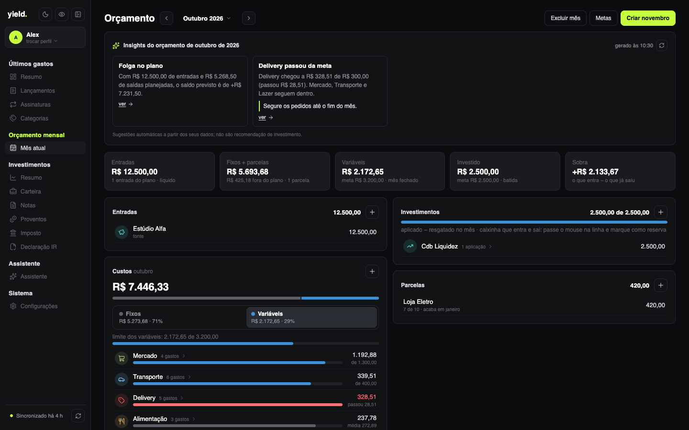
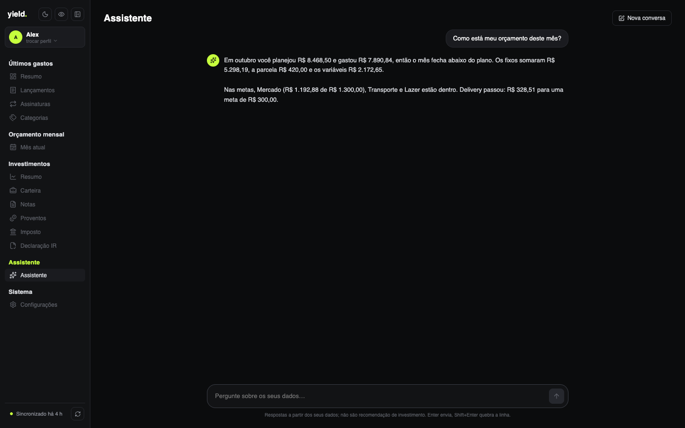
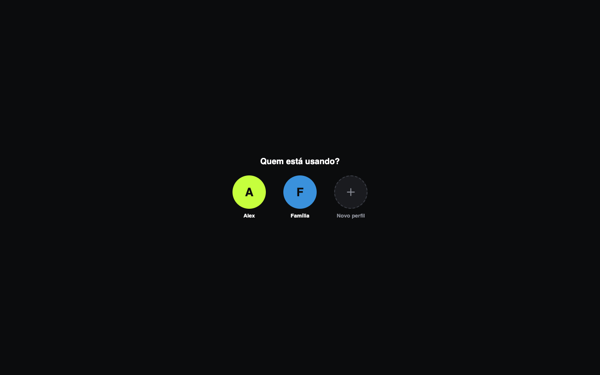
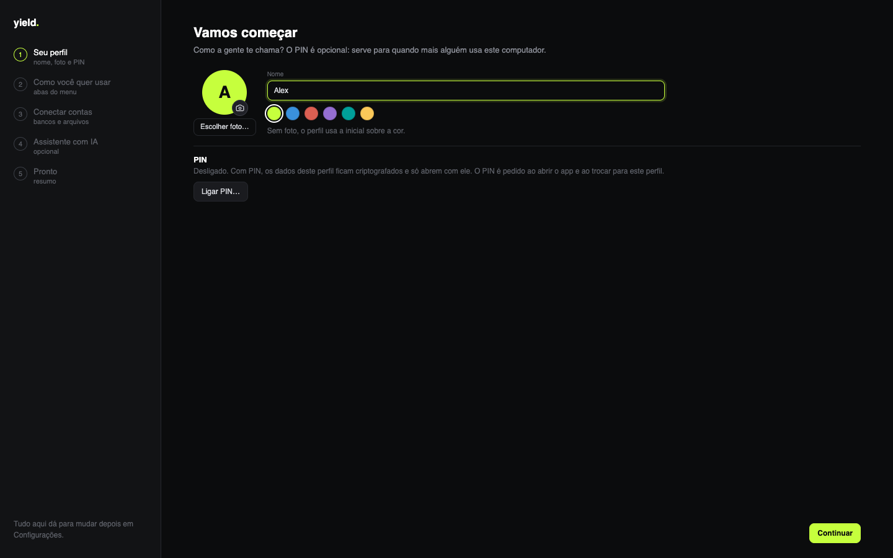
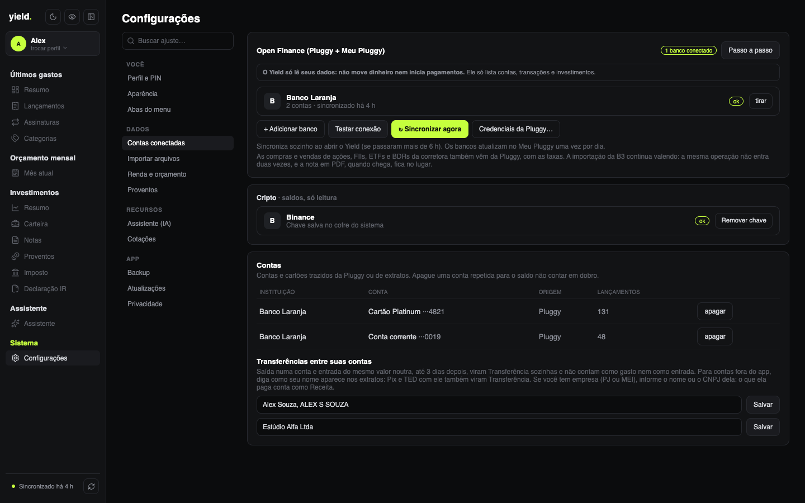

<p align="center">
  
</p>

<h1 align="center">yield<span>.</span></h1>

<p align="center">
  <b>Finanças pessoais que ficam no seu computador.</b><br>
  Gastos do mês, orçamento, carteira de investimentos, imposto de renda da bolsa<br>
  e um assistente com IA que roda na sua máquina, num app de desktop para macOS e Windows.<br>
  Sem conta, sem servidor, sem telemetria.
</p>

<p align="center">
  
  
  
  
  
  
</p>

<p align="center">
  
</p>

> Todas as imagens usam dados inventados. O que mudou em cada versão está no [CHANGELOG](CHANGELOG.md).

---

## Por que existe

O yield nasceu para aposentar duas planilhas: uma de controle de investimentos (preço médio, IR, DARF) e outra de orçamento do mês. A ideia é ter as duas coisas num app só, rápido, bonito e **privado**. Tudo é gravado num arquivo SQLite na sua máquina (criptografado, se o perfil tiver PIN), e você exporta ou importa um backup quando quiser.

Só isto sai do computador:

- as **cotações** do Yahoo Finance (e o histórico mensal, para o gráfico contra o Ibovespa);
- a série do **CDI** do Banco Central;
- a **leitura dos seus bancos** pela Pluggy/Meu Pluggy, se você ligar o Open Finance;
- a **leitura dos saldos da Binance**, se você salvar uma chave só de leitura;
- o **download do modelo de IA** no Hugging Face, uma vez, se você ativar o Assistente (as perguntas e os seus dados nunca saem da máquina);
- nada mais.

## O que ele faz

### 💸 Últimos gastos

| | |
|---|---|
| **Resumo** | **Insights do mês** gerados pelo Assistente; gasto, entradas, quanto sobrou e o **orçamento do mês com a projeção** "no ritmo atual fecha em…"; **saldo nas contas** e a fatura do cartão (pela Pluggy); o que mais mudou contra o mês anterior; gasto acumulado dia a dia; categorias com a barra do orçamento; últimos 6 meses com o traço do planejado (clicar num mês troca o resumo); maiores gastos e próximas cobranças. |
| **Lançamentos** | Conta e cartão juntos, um cartão por dia, com o nome do lugar limpo ("Pix enviado · Padaria Sol") e a conta curta. Faixa de categorias para filtrar, total do que está filtrado e grade de categorias com ícones para trocar a de uma compra — ou criar a regra "sempre categorizar *X* como *Y*". |
| **Assinaturas** | Detecta cobranças que se repetem todo mês ou todo ano e avisa quando o preço sobe. Próximas cobranças, o peso de cada uma no total do mês e exclusão com confirmação. Parcelas não entram. |
| **Categorias** | Grade com o gasto do mês, a variação contra o mês anterior e a barra do orçamento; ícone e cor escolhidos por você; regras com prévia ("pegaria 17 compras") e sugestões a partir do que você categoriza à mão; apagar uma categoria move as compras e regras para outra. Pagamento de fatura, transferência e investimento não contam como gasto. |

As transações chegam de dois jeitos:

- **Open Finance (Pluggy + Meu Pluggy)**, de graça para uso pessoal, **somente leitura**;
- **extratos** OFX (Bradesco, Itaú, BB, Inter…) e CSV de qualquer banco ou cartão (Nubank e Mercado Pago reconhecidos sozinhos; nos outros você escolhe as colunas de data, descrição e valor). Importar o mesmo arquivo de novo não duplica nada.

<p align="center">
  
</p>

<p align="center">
  
</p>

<p align="center">
  
</p>

### 🗓️ Orçamento mensal

| | |
|---|---|
| **Mês atual** | No jeito de uma planilha de controle, em blocos: **O que eu ganho**, **Custos**, **Investimentos** e **Parcelas**, com os números do mês no topo (entradas, fixos + parcelas, variáveis, investido e a sobra do que já saiu) e os insights do Assistente. |
| **Custos** | Abas **Fixos** e **Variáveis** com o total, a proporção entre os dois e cada categoria com ícone, barra e a lista de gastos. Nos fixos, o que está no plano (com "pago ✓" quando o lançamento aparece) e o que saiu fora dele. Os gastos vêm dos lançamentos, sem digitar, e parcelas, assinaturas e contas pagas pelo banco não contam duas vezes. |
| **Metas** | Quanto investir, um limite para os variáveis e uma meta por categoria, com a média dos últimos 3 meses ao lado. Valem do mês em diante, sem mudar os anteriores. |
| **Entradas e investido** | O salário das fontes de renda entra sozinho em todo mês novo; o que entrou de terceiros (Pix, TED) também aparece, sem as transferências entre contas suas. O investido sai dos lançamentos para a categoria Investimento ou uma reserva sua, e o cartão **Reserva** mostra o saldo dela no banco. |
| **Meses** | Criar o mês seguinte com as linhas recorrentes e as parcelas avançando sozinhas (e sumindo depois da última), trazer o plano do mês anterior para um mês vazio e excluir um mês. |
| **Sugestões** | Assinaturas e parcelas que faltam, vindas dos seus gastos reais. Nada entra no plano sem você aceitar. |
| **Fontes de renda** | Salário **CLT** (INSS e IRRF de 2026, com a isenção até R$ 5 mil, dependentes e outros descontos), **PJ** (pró-labore, IRPJ, INSS, contabilidade), **MEI** (DAS fixo) ou valor fixo; mudar uma fonte atualiza este mês e os próximos. |
| **Importação** | Lê um CSV simples (`mes;tipo;nome;valor`, com exemplo na tela) com o orçamento de vários meses, sem duplicar ao reimportar. |

<p align="center">
  
</p>

### 📈 Investimentos

| | |
|---|---|
| **Resumo** | Insights do Assistente; patrimônio (com o que saiu do seu bolso, se você reinveste os proventos), resultado, proventos (com o rendimento sobre o custo) e imposto; **onde está seu dinheiro** (bolsa, renda fixa, exterior, cripto e dólar); **quanto da sua renda passiva já cobre o gasto médio**; **rentabilidade em 12 meses contra o CDI e o Ibovespa**; aportado × valor de hoje; classes com o ganho de cada uma; proventos por mês (clicar abre Proventos filtrado); maiores posições. |
| **Carteira** | Classes à esquerda (com peso, total e resultado) e as posições da classe à direita, todas no mesmo formato. **Renda fixa da B3** (Tesouro, CDB, LCI/LCA…) com aplicado, valor de hoje e rendimento de cada título; **cripto da Binance** (saldos lidos com uma chave só de leitura, com o aportado que você informa); **ações do exterior** por ticker e quantidade, convertidas pelo dólar do dia; **investimentos do banco** que a Pluggy informa (RDB, caixinhas, fundos, CDB), só leitura; e ativos manuais. |
| **Notas** | Compras e vendas **importadas do relatório de Negociação da B3**, notas de corretagem digitadas ou **lidas do PDF no padrão SINACOR** (Clear, XP, Rico e outras) (com taxas rateadas), e eventos corporativos (bonificação, desdobramento, grupamento, troca de ticker). |
| **Proventos** | Dividendos, JCP, rendimentos e juros da renda fixa (importados da B3 ou à mão), com insights do Assistente: 12 meses, ano contra ano, rendimento sobre o custo, gráfico de 24 meses que filtra a lista, ranking por ativo e totais por ano. |
| **Imposto** | Apuração mensal de renda variável: isenção de R$ 20 mil para ações, prejuízo a compensar (comum e FII), IRRF, DARF (código 6015) com vencimento em dia útil e acompanhamento do que foi pago. |
| **Declaração IR** | Tudo o que vai na declaração sobre a bolsa, pronto para copiar campo a campo: **Bens e Direitos** (grupo/código, CNPJ, situação nos dois 31/12 e a discriminação pronta), **Rendimentos** isentos e de tributação exclusiva por fonte pagadora, **Renda variável** mês a mês e o cadastro de empresas e corretoras (empresas e fundos preenchidos pela Posição da B3). |

<p align="center">
  
</p>

<p align="center">
  
</p>

### 🤖 Assistente (IA local, opcional)

| | |
|---|---|
| **Chat** | Pergunte em português ("como está meu orçamento deste mês?", "minha carteira rendeu mais que o CDI?"). O modelo consulta os seus dados por ferramentas só de leitura (gastos, lançamentos, orçamento, carteira, rentabilidade, proventos) e responde com os números deles. |
| **Insights** | Cards automáticos nos Resumos de gastos e de investimentos, no Orçamento e em Proventos, gerados quando os números do mês mudam. |
| **Conferência** | Todo valor em R$ e % é conferido contra os dados do app: insight com número inventado é descartado, e no chat o valor que não veio das ferramentas aparece como "não conferido". |
| **Na sua máquina** | `llama.cpp` vem no instalador; o modelo (Qwen3 8B ou 4B, escolhido pela memória do computador) é baixado no primeiro uso. Nada é enviado para a internet. Ligar e desligar em Configurações › Assistente (IA). |

<p align="center">
  
</p>

### ⚙️ Sistema

- **Perfis**: um perfil por pessoa que usa o computador (ou por cenário). Cada perfil tem seus próprios dados, credenciais (Pluggy, Binance) e preferências de tela. Crie um perfil novo no menu do topo da sidebar; troque entre perfis ali mesmo ou pela tela "Quem está usando?", que aparece ao abrir o app se houver 2 ou mais perfis. Edite o nome, a cor e a foto do perfil em Configurações › Perfil e PIN; apague um perfil e seus dados só nesse lugar (o último não pode ser apagado). Dados antigos viram o primeiro perfil automaticamente; quem está atualizando vê só um perfil e o app abre direto nele (sem mudança visível).
- **PIN por perfil** (opcional, 4 dígitos), em Configurações › Perfil e PIN: com PIN, o banco e as credenciais do perfil ficam criptografados e só abrem com ele. **Esqueceu, perdeu:** o único jeito de recuperar os dados é um backup. Errar 5 vezes faz esperar 1 min; cada nova rodada de 5 erros aumenta para 5 min, 15 min e 1 h. Nunca apaga dados. 4 dígitos protegem de quem usa este computador, não de quem copia o arquivo e testa as 10 mil combinações por fora. Cópias feitas fora do app antes de ligar o PIN (Time Machine, backups do sistema) continuam sem criptografia. Um backup pode virar um perfil novo em "Novo perfil" › "Restaurar de um backup".
- Importa da Área do Investidor da B3 os relatórios de Negociação, Proventos Recebidos, Movimentação e Posição, vários de uma vez, sem duplicar.
- Backup num arquivo `.yield` criptografado com uma senha sua (AES-256-GCM, chave derivada com Argon2id). O arquivo salvo é do perfil aberto quando você exporta; antes de importar um backup, o app guarda uma cópia de segurança do perfil atual.
- Sincronização sozinha com o app aberto: cotações e Binance a cada 15 minutos, Open Finance a cada 6 horas. O status de cada fonte fica no rodapé do menu, com "Sincronizar tudo".
- Setup inicial na primeira abertura e em cada perfil novo (perfil e PIN, quais abas mostrar, contas, Assistente) e um tour curto pelo app; refazer e rever em Configurações › Perfil e PIN.
- Configurações em seções (Você, Dados, Recursos, App) com busca por ajuste; a seção aberta por último fica lembrada em cada perfil. Em **Contas conectadas**, cada banco aparece com a situação, reconectar e as credenciais atrás de um link.
- **Tema claro, escuro ou do sistema**, no botão do menu; **olhinho** que esconde os valores em todas as telas; módulos (Últimos gastos, Orçamento, Investimentos) ligados ou desligados; menu recolhível só com ícones; o app abre na última tela usada.

<p align="center">
  
  
</p>
- Atualização automática: o app avisa quando sai versão nova no GitHub e se atualiza sozinho (pacotes assinados).

## 🔒 Privacidade e segurança

- **Open Finance somente leitura.** O cliente da Pluggy só consegue fazer `POST /auth` (no Rust), `GET /accounts`, `GET /v2/transactions` e `GET /investments` (com as operações de cada investimento). Qualquer outra rota é recusada antes de sair da máquina, e há um teste que garante isso. O app nunca move dinheiro nem inicia pagamentos.
- **Binance somente leitura.** O Rust assina só as leituras da lista (saldo da conta e do Simple Earn, compras por PIX/cartão, Converter e negociações à vista); qualquer outra chamada é recusada antes de sair da máquina, e a guia pede uma chave com só "Enable Reading".
- **IA sem internet.** O `llama-server` escuta só em `127.0.0.1`, com porta e chave aleatórias a cada vez que sobe. O modelo vem de um endereço do Hugging Face fixado num commit e só é usado se o SHA-256 bater.
- **Backup com senha.** O arquivo exportado só abre com a senha escolhida na hora; sem ela nem o Yield recupera os dados.
- **Credenciais no cofre do sistema** (Pluggy e Binance): Keychain no macOS, Credential Manager no Windows, lidas só pelo Rust. Elas nunca chegam ao JavaScript nem vão para o banco, para o backup ou para log.
- **Perfil com PIN criptografado no disco.** O banco usa SQLCipher; a chave sai do PIN com Argon2id e o item do cofre do perfil é selado com AES-256-GCM. Com o app fechado ou o perfil bloqueado, nada do perfil fica legível.
- **Rede restrita.** A CSP não deixa a tela falar com a internet; o plugin HTTP do Tauri só libera o Yahoo Finance, `api.bcb.gov.br` (CDI) e `api.pluggy.ai`, e a Binance, a autenticação da Pluggy e o download do modelo saem pelo Rust, cada um só para o seu endereço.
- **Seus arquivos fora do git.** `planilhas/`, `notas/` e `extratos/` são ignorados; os testes usam só dados sintéticos.

<p align="center">
  
</p>

## Como rodar

Pré-requisitos: [Node](https://nodejs.org) 24 (veja `.nvmrc`), [pnpm](https://pnpm.io), [Rust](https://rustup.rs) com os [pré-requisitos do Tauri](https://tauri.app/start/prerequisites/) e [CMake](https://cmake.org) (para o `llama-server` do Assistente).

```bash
pnpm install
pnpm llama          # compila o llama-server do Assistente (uma vez por versão; o Tauri precisa dele para compilar)
pnpm tauri dev      # abre o app em modo de desenvolvimento
pnpm test           # testes (Vitest)
pnpm tauri build    # gera o instalador (.dmg no macOS)
```

O instalador de Windows sai pelo workflow **Build Windows** do GitHub Actions (`.github/workflows/build.yml`), que roda manualmente.

### Conectar os bancos

O caminho gratuito é o conector **MeuPluggy**. O teste da Pluggy dura 15 dias e é nesse período que dá para adicionar bancos, então siga o passo a passo **antes** de criar a conta: [`docs/roteiro-pluggy.md`](docs/roteiro-pluggy.md).

## Arquitetura

```
src/
  domain/        regras puras: preço médio, imposto, DARF, categorias, assinaturas
  import/        relatórios da B3, nota em PDF (SINACOR), orçamento em CSV, OFX e CSV
  openfinance/   cliente Pluggy só leitura, sincronização
  cripto/        Binance só leitura e custo médio da cripto
  quotes/        cotações e histórico (Yahoo) e CDI (Banco Central)
  ai/            Assistente: fatos, ferramentas, insights, conferência dos valores e bateria de avaliação
  profiles/      perfis, PIN e a tela "Quem está usando?"
  onboarding/    setup inicial e tour
  db/            SQLite (migrações em src-tauri/migrations)
  state/         DataProvider: carrega o banco e deriva tudo em memória
  pages/         telas (cada uma com um build.ts testado)
  ui/            navegação e gráficos em SVG feitos à mão
src-tauri/       Tauri 2 + Rust: banco com SQLCipher, cofre (crate keyring), backup, Pluggy/Binance assinados e o llama-server
```

Os dados de origem ficam no SQLite (notas, operações, proventos, transações, categorias), e tudo o mais é calculado: posições, imposto, totais e assinaturas. Dinheiro é sempre um inteiro em centavos.

Spec, planos e telas aprovadas estão em [`docs/`](docs).

## Roadmap

- [x] **Fase 1: Investimentos.** Carteira, notas, proventos, imposto, importação da B3 e backup.
- [x] **Fase 3: Últimos gastos.** Open Finance só leitura, extratos, categorias, assinaturas e resumos com gráficos.
- [x] **Fase 2: Orçamento mensal.** Plano do mês em blocos, fontes de renda (CLT, PJ, MEI ou valor fixo), metas, reserva, mês seguinte com recorrentes e parcelas, planejado × real e sugestões vindas dos gastos.
- [x] **Assistente com IA local.** Chat com ferramentas só de leitura e insights conferidos contra os dados.
- [x] **Perfis e PIN.** Vários perfis no mesmo computador, dados criptografados com PIN, setup inicial e tour.
- [ ] Planejamento (simulações) e milhas.

## Licença

[MIT](LICENSE).

### Licenças de terceiros

- [SQLCipher](https://www.zetetic.net/sqlcipher/) (BSD-3-Clause, Zetetic LLC): criptografia do banco. Texto em [`src-tauri/licenses/SQLCipher-LICENSE.txt`](src-tauri/licenses/SQLCipher-LICENSE.txt).
- [OpenSSL 3](https://www.openssl.org/) (Apache-2.0), só no Windows, por baixo do SQLCipher. Texto em [`src-tauri/licenses/OpenSSL-LICENSE.txt`](src-tauri/licenses/OpenSSL-LICENSE.txt).

As duas licenças vão junto com o app instalado.
