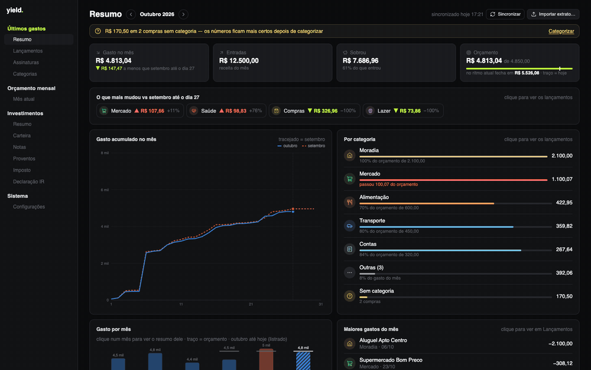
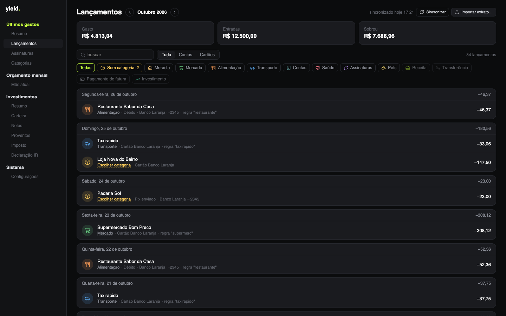
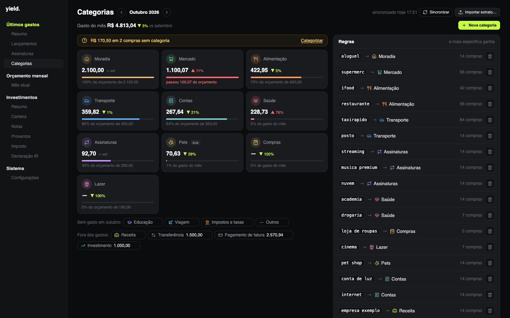
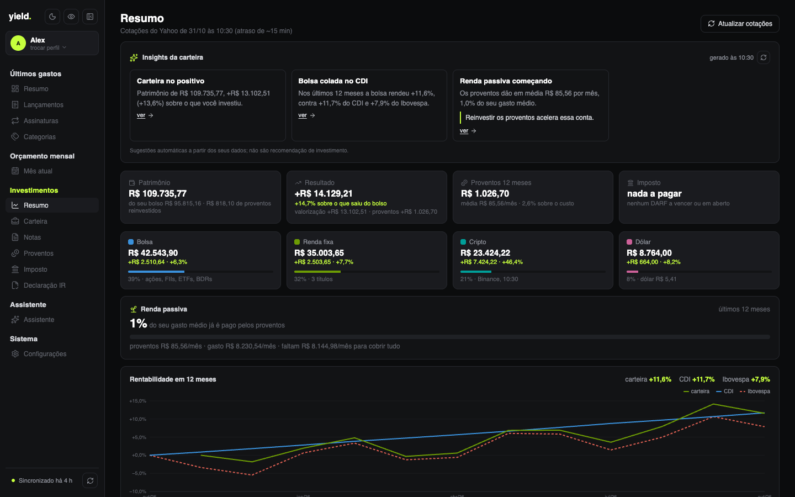
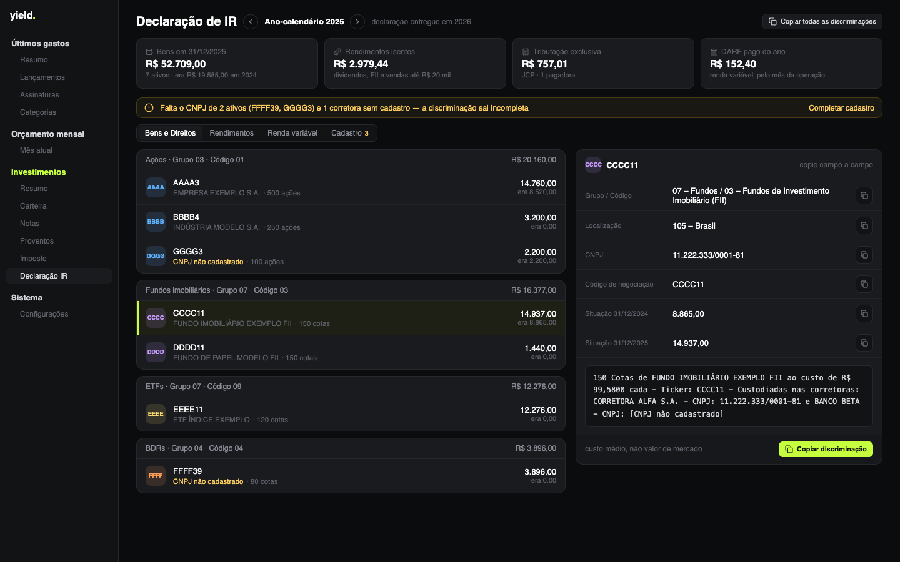
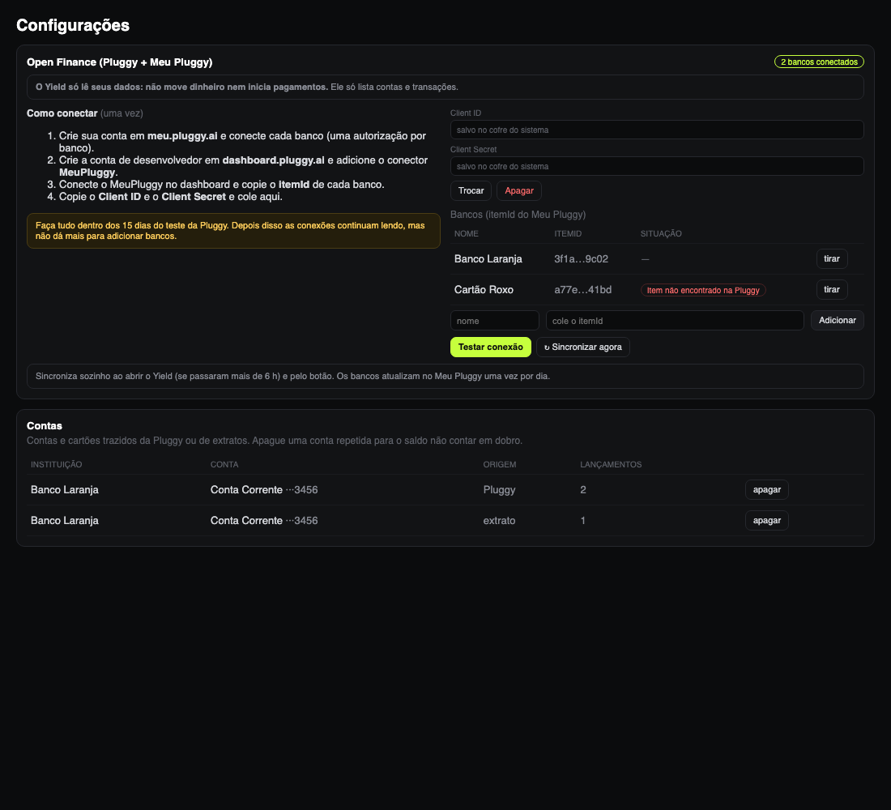

<p align="center">
  
</p>

<h1 align="center">yield<span>.</span></h1>

<p align="center">
  <b>Finanças pessoais que ficam no seu computador.</b><br>
  Gastos do mês, assinaturas, carteira de investimentos e imposto de renda da bolsa,<br>
  num app de desktop para macOS e Windows. Sem conta, sem servidor, sem telemetria.
</p>

<p align="center">
  
  
  
  
  
  
</p>

<p align="center">
  
</p>

> Todas as imagens usam dados inventados. O que mudou em cada versão está no [CHANGELOG](CHANGELOG.md).

---

## Por que existe

O yield nasceu para aposentar duas planilhas: uma de controle de investimentos (preço médio, IR, DARF) e outra de orçamento do mês. A ideia é ter as duas coisas num app só, rápido, bonito e **privado**. Tudo é gravado num arquivo SQLite na sua máquina, e você exporta ou importa um backup quando quiser.

Só isto sai do computador:

- as **cotações** do Yahoo Finance (e o histórico mensal, para o gráfico contra o Ibovespa);
- a série do **CDI** do Banco Central;
- a **leitura dos seus bancos** pela Pluggy/Meu Pluggy, se você ligar o Open Finance;
- nada mais.

## O que ele faz

### 💸 Últimos gastos

| | |
|---|---|
| **Resumo** | Gasto, entradas, quanto sobrou e o **orçamento do mês com a projeção** "no ritmo atual fecha em…"; o que mais mudou contra o mês anterior; gasto acumulado dia a dia; categorias com a barra do orçamento; últimos 6 meses com o traço do planejado (clicar num mês troca o resumo); maiores gastos e próximas cobranças. |
| **Lançamentos** | Conta e cartão juntos, um cartão por dia, com o nome do lugar limpo ("Pix enviado · Padaria Sol") e a conta curta. Faixa de categorias para filtrar, total do que está filtrado e grade de categorias com ícones para trocar a de uma compra — ou criar a regra "sempre categorizar *X* como *Y*". |
| **Assinaturas** | Detecta cobranças que se repetem todo mês ou todo ano e avisa quando o preço sobe. Próximas cobranças, o peso de cada uma no total do mês e exclusão com confirmação. Parcelas não entram. |
| **Categorias** | Grade com o gasto do mês, a variação contra o mês anterior e a barra do orçamento; ícone e cor escolhidos por você; regras com prévia ("pegaria 17 compras") e sugestões a partir do que você categoriza à mão; apagar uma categoria move as compras e regras para outra. Pagamento de fatura, transferência e investimento não contam como gasto. |

As transações chegam de dois jeitos:

- **Open Finance (Pluggy + Meu Pluggy)**, de graça para uso pessoal, **somente leitura**;
- **extratos** OFX (Bradesco, Itaú, BB, Inter…) e CSV de qualquer banco ou cartão (Nubank e Mercado Pago reconhecidos sozinhos; nos outros você escolhe as colunas de data, descrição e valor). Importar o mesmo arquivo de novo não duplica nada.

<p align="center">
  
</p>

<p align="center">
  
</p>

### 🗓️ Orçamento mensal

| | |
|---|---|
| **Mês atual** | Entradas, saídas e saldo do mês; planejado × gasto real até agora (com a marca de quanto do mês passou) e por categoria; criar o mês seguinte copiando as linhas recorrentes, com as parcelas avançando sozinhas. |
| **Sugestões** | Assinaturas e parcelas que faltam, vindas dos seus gastos reais. Nada entra no plano sem você aceitar. |
| **Fontes de renda** | Salário **CLT** (INSS e IRRF de 2026, com a isenção até R$ 5 mil, dependentes e outros descontos), salário **PJ** (pró-labore, IRPJ, INSS, contabilidade) ou valor fixo; mudar uma fonte atualiza este mês e os próximos. |
| **Importação** | Lê um CSV simples (`mes;tipo;nome;valor`, com exemplo na tela) com o orçamento de vários meses, sem duplicar ao reimportar. |

### 📈 Investimentos

| | |
|---|---|
| **Resumo** | Patrimônio, resultado, proventos (com o rendimento sobre o custo) e imposto; **onde está seu dinheiro** (bolsa, renda fixa, exterior, cripto e dólar); **quanto da sua renda passiva já cobre o gasto médio**; **rentabilidade em 12 meses contra o CDI e o Ibovespa**; aportado × valor de hoje; classes com o ganho de cada uma; proventos por mês (clicar abre Proventos filtrado); maiores posições. |
| **Carteira** | Classes à esquerda (com peso, total e resultado) e as posições da classe à direita, todas no mesmo formato. **Renda fixa da B3** (Tesouro, CDB, LCI/LCA…) com aplicado, valor de hoje e rendimento de cada título; **cripto da Binance** (saldos lidos com uma chave só de leitura, com o aportado que você informa); **ações do exterior** por ticker e quantidade, convertidas pelo dólar do dia; e ativos manuais. |
| **Notas** | Compras e vendas **importadas do relatório de Negociação da B3**, notas de corretagem digitadas ou **lidas do PDF no padrão SINACOR** (Clear, XP, Rico e outras) (com taxas rateadas), e eventos corporativos (bonificação, desdobramento, grupamento, troca de ticker). |
| **Proventos** | Dividendos, JCP, rendimentos e juros da renda fixa (importados da B3 ou à mão): 12 meses, ano contra ano, rendimento sobre o custo, gráfico de 24 meses que filtra a lista, ranking por ativo e totais por ano. |
| **Imposto** | Apuração mensal de renda variável: isenção de R$ 20 mil para ações, prejuízo a compensar (comum e FII), IRRF, DARF (código 6015) com vencimento em dia útil e acompanhamento do que foi pago. |
| **Declaração IR** | Tudo o que vai na declaração sobre a bolsa, pronto para copiar campo a campo: **Bens e Direitos** (grupo/código, CNPJ, situação nos dois 31/12 e a discriminação pronta), **Rendimentos** isentos e de tributação exclusiva por fonte pagadora, **Renda variável** mês a mês e o cadastro de empresas e corretoras (empresas e fundos preenchidos pela Posição da B3). |

<p align="center">
  
</p>

<p align="center">
  
</p>

### ⚙️ Sistema

- **Perfis**: um perfil por pessoa que usa o computador (ou por cenário). Cada perfil tem seus próprios dados, credenciais (Pluggy, Binance) e preferências de tela. Crie um perfil novo no menu do topo da sidebar; troque entre perfis ali mesmo ou pela tela "Quem está usando?", que aparece ao abrir o app se houver 2 ou mais perfis. Edite o nome, a cor e a foto do perfil em Configurações › Perfil; apague um perfil e seus dados só nesse lugar. Se há só um perfil, o app abre direto nele (sem muda visível para quem está atualizando).
- Importa da Área do Investidor da B3 os relatórios de Negociação, Proventos Recebidos, Movimentação e Posição, vários de uma vez, sem duplicar.
- Backup num arquivo `.yield` criptografado com uma senha sua (AES-256-GCM, chave derivada com Argon2id). O arquivo salvo é do perfil aberto quando você exporta; antes de importar um backup, o app guarda uma cópia de segurança do perfil atual. Cada perfil tem seu histórico de backups.
- Cotações automáticas a cada 15 minutos.
- Atualização automática: o app avisa quando sai versão nova no GitHub e se atualiza sozinho (pacotes assinados).

## 🔒 Privacidade e segurança

- **Open Finance somente leitura.** O cliente da Pluggy só consegue fazer `POST /auth`, `GET /accounts` e `GET /v2/transactions`. Qualquer outra rota é recusada antes de sair da máquina, e há um teste que garante isso. O app nunca move dinheiro nem inicia pagamentos.
- **Binance somente leitura.** O Yield só faz três leituras assinadas (saldo da conta e do Simple Earn); qualquer outra chamada é recusada antes de sair da máquina, e a guia pede uma chave com só "Enable Reading".
- **Backup com senha.** O arquivo exportado só abre com a senha escolhida na hora; sem ela nem o Yield recupera os dados.
- **Credenciais no cofre do sistema** (Pluggy e Binance): Keychain no macOS, Credential Manager no Windows. Elas nunca vão para o banco, para o backup ou para log.
- **Rede restrita.** As permissões do Tauri só liberam o Yahoo Finance, `api.bcb.gov.br` (CDI), `api.pluggy.ai` e `api.binance.com`.
- **Seus arquivos fora do git.** `planilhas/`, `notas/` e `extratos/` são ignorados; os testes usam só dados sintéticos.

<p align="center">
  
</p>

## Como rodar

Pré-requisitos: [Node](https://nodejs.org) 24 (veja `.nvmrc`), [pnpm](https://pnpm.io), [Rust](https://rustup.rs) com os [pré-requisitos do Tauri](https://tauri.app/start/prerequisites/) e [CMake](https://cmake.org) (para o `llama-server` do Assistente).

```bash
pnpm install
pnpm llama          # compila o llama-server do Assistente (uma vez por versão; o Tauri precisa dele para compilar)
pnpm tauri dev      # abre o app em modo de desenvolvimento
pnpm test           # testes (Vitest)
pnpm tauri build    # gera o instalador (.dmg no macOS)
```

O instalador de Windows sai pelo workflow **Build Windows** do GitHub Actions (`.github/workflows/build.yml`), que roda manualmente.

### Conectar os bancos

O caminho gratuito é o conector **MeuPluggy**. O teste da Pluggy dura 15 dias e é nesse período que dá para adicionar bancos, então siga o passo a passo **antes** de criar a conta: [`docs/roteiro-pluggy.md`](docs/roteiro-pluggy.md).

## Arquitetura

```
src/
  domain/        regras puras: preço médio, imposto, DARF, categorias, assinaturas
  import/        relatórios da B3, nota em PDF (SINACOR), orçamento em CSV, OFX e CSV
  openfinance/   cliente Pluggy só leitura, sincronização, cofre
  db/            SQLite (migrações em src-tauri/migrations)
  state/         DataProvider: carrega o banco e deriva tudo em memória
  pages/         telas (cada uma com um build.ts testado)
  ui/            navegação e gráficos em SVG feitos à mão
src-tauri/       Tauri 2 + Rust (troca de banco no backup, cofre com o crate keyring)
```

Os dados de origem ficam no SQLite (notas, operações, proventos, transações, categorias), e tudo o mais é calculado: posições, imposto, totais e assinaturas. Dinheiro é sempre um inteiro em centavos.

Spec, planos e telas aprovadas estão em [`docs/`](docs).

## Roadmap

- [x] **Fase 1: Investimentos.** Carteira, notas, proventos, imposto, importação da B3 e backup.
- [x] **Fase 3: Últimos gastos.** Open Finance só leitura, extratos, categorias, assinaturas e resumos com gráficos.
- [x] **Fase 2: Orçamento mensal.** Plano do mês, fontes de renda (PJ calculado ou valor fixo), mês seguinte com recorrentes e parcelas, planejado × real e sugestões vindas dos gastos.
- [ ] Planejamento (simulações) e milhas.

## Licença

[MIT](LICENSE).
