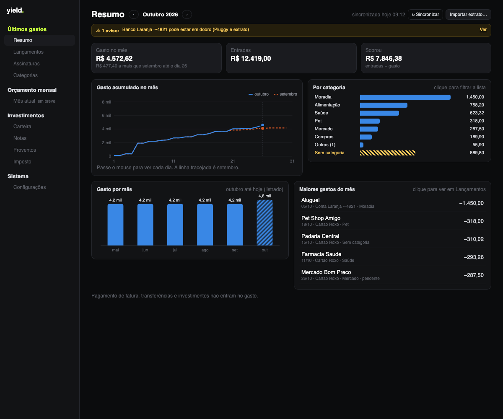

<p align="center">
  
</p>

<h1 align="center">yield<span>.</span></h1>

<p align="center">
  <b>Finanças pessoais que ficam no seu computador.</b><br>
  Gastos do mês, assinaturas, carteira de investimentos e imposto de renda da bolsa,<br>
  num app de desktop para macOS e Windows. Sem conta, sem servidor, sem telemetria.
</p>

<p align="center">
  
  
  
  
  
</p>

<p align="center">
  
</p>

> Todas as imagens usam dados inventados.

---

## Por que existe

O yield nasceu para aposentar duas planilhas: uma de controle de investimentos (preço médio, IR, DARF) e outra de orçamento do mês. A ideia é ter as duas coisas num app só, rápido, bonito e **privado**. Tudo é gravado num arquivo SQLite na sua máquina, e você exporta ou importa um backup quando quiser.

Só três coisas saem do computador:

- as **cotações** do Yahoo Finance;
- a **leitura dos seus bancos** pela Pluggy/Meu Pluggy, se você ligar o Open Finance;
- nada mais.

## O que ele faz

### 💸 Últimos gastos

| | |
|---|---|
| **Resumo** | Gasto, entradas e quanto sobrou no mês; gasto acumulado dia a dia contra o mês anterior; gasto por categoria (clicar filtra a lista); últimos 6 meses; maiores gastos. |
| **Lançamentos** | Conta e cartão juntos, por dia, com busca e filtros. Trocar a categoria de uma compra ou criar a regra "sempre categorizar *X* como *Y*". |
| **Assinaturas** | Detecta cobranças que se repetem todo mês ou todo ano, com valor parecido, e avisa quando o preço sobe. Parcelas não entram. |
| **Categorias** | Categorias e regras editáveis. Pagamento de fatura, transferência e investimento não contam como gasto, então a compra no cartão não aparece duas vezes. |

As transações chegam de dois jeitos:

- **Open Finance (Pluggy + Meu Pluggy)**, de graça para uso pessoal, **somente leitura**;
- **extratos** OFX (Bradesco, Itaú, BB, Inter…) e CSV (Nubank conta, Mercado Pago). Importar o mesmo arquivo de novo não duplica nada.

<p align="center">
  
</p>

### 📈 Investimentos

| | |
|---|---|
| **Resumo** | Patrimônio, resultado, proventos e imposto num só lugar; aportado ao longo do tempo × valor de hoje; patrimônio por classe; proventos por mês (rendimento, dividendo, JCP); maiores posições. |
| **Carteira** | Posições com preço médio, custo, cotação e variação, agrupadas por classe, mais ativos manuais (renda fixa, cripto, dólar). |
| **Notas** | Notas de corretagem digitadas ou **lidas do PDF da Clear**, com taxas rateadas. Também operações sem nota e eventos corporativos (bonificação, desdobramento, grupamento, troca de ticker). |
| **Proventos** | Dividendos, JCP e rendimentos, importados do extrato da B3 ou lançados à mão. |
| **Imposto** | Apuração mensal de renda variável: isenção de R$ 20 mil para ações, prejuízo a compensar (comum e FII), IRRF, DARF (código 6015) com vencimento em dia útil e acompanhamento do que foi pago. |

<p align="center">
  
</p>

### ⚙️ Sistema

- Importa a planilha antiga e o extrato de movimentação da B3.
- Backup em um arquivo `.db`. Antes de importar um backup, o app guarda uma cópia de segurança do banco atual.
- Cotações automáticas a cada 15 minutos.

## 🔒 Privacidade e segurança

- **Open Finance somente leitura.** O cliente da Pluggy só consegue fazer `POST /auth`, `GET /accounts` e `GET /v2/transactions`. Qualquer outra rota é recusada antes de sair da máquina, e há um teste que garante isso. O app nunca move dinheiro nem inicia pagamentos.
- **Credenciais no cofre do sistema**: Keychain no macOS, Credential Manager no Windows. Elas nunca vão para o banco, para o backup ou para log.
- **Rede restrita.** As permissões do Tauri só liberam o Yahoo Finance e `api.pluggy.ai`.
- **Seus arquivos fora do git.** `planilhas/`, `notas/` e `extratos/` são ignorados; os testes usam só dados sintéticos.

<p align="center">
  
</p>

## Como rodar

Pré-requisitos: [Node](https://nodejs.org) 24 (veja `.nvmrc`), [pnpm](https://pnpm.io) e [Rust](https://rustup.rs) com os [pré-requisitos do Tauri](https://tauri.app/start/prerequisites/).

```bash
pnpm install
pnpm tauri dev      # abre o app em modo de desenvolvimento
pnpm test           # testes (Vitest)
pnpm tauri build    # gera o instalador (.dmg no macOS)
```

O instalador de Windows sai pelo workflow **Build Windows** do GitHub Actions (`.github/workflows/build.yml`), que roda manualmente.

### Conectar os bancos

O caminho gratuito é o conector **MeuPluggy**. O teste da Pluggy dura 15 dias e é nesse período que dá para adicionar bancos, então siga o passo a passo **antes** de criar a conta: [`docs/roteiro-pluggy.md`](docs/roteiro-pluggy.md).

## Arquitetura

```
src/
  domain/        regras puras: preço médio, imposto, DARF, categorias, assinaturas
  import/        planilha, extrato da B3, PDF da Clear, OFX e CSV
  openfinance/   cliente Pluggy só leitura, sincronização, cofre
  db/            SQLite (migrações em src-tauri/migrations)
  state/         DataProvider: carrega o banco e deriva tudo em memória
  pages/         telas (cada uma com um build.ts testado)
  ui/            navegação e gráficos em SVG feitos à mão
src-tauri/       Tauri 2 + Rust (troca de banco no backup, cofre com o crate keyring)
```

Os dados de origem ficam no SQLite (notas, operações, proventos, transações, categorias), e tudo o mais é calculado: posições, imposto, totais e assinaturas. Dinheiro é sempre um inteiro em centavos.

Spec, planos e telas aprovadas estão em [`docs/`](docs).

## Roadmap

- [x] **Fase 1: Investimentos.** Carteira, notas, proventos, imposto, importação e backup.
- [x] **Fase 3: Últimos gastos.** Open Finance só leitura, extratos, categorias, assinaturas e resumos com gráficos.
- [ ] **Fase 2: Orçamento mensal.** Plano do mês com entradas e saídas (inclusive salário PJ líquido), meses que se repetem e planejado × real.
